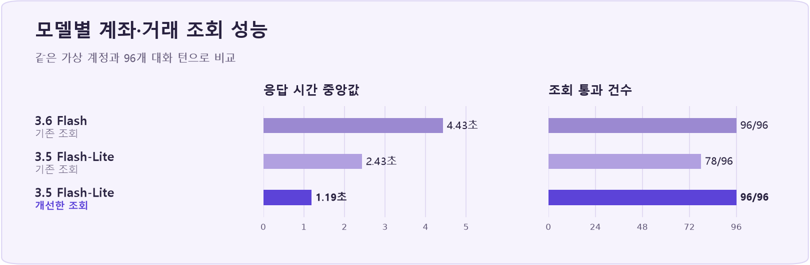

# 내금고

<p align="center">
  <a href="https://naengo.com"></a>
</p>


| 프로젝트 기간 | 설계 | 구현 |
|---|---|---|
| 2026.11.03 ~ 2026.11.11 | 4인 공동 설계 | 개인 구현 |

화면에서 계좌를 조회하고 송금할 수 있으며, 챗봇에서는 같은 계좌의 거래내역을 분석하거나 금융 문서에 근거한 답변을 받을 수 있습니다.

[**운영 데모 열기 ↗**](https://naengo.com) · [주요 기능](#주요-기능) · [테스트와 결과](#테스트와-결과) · [회고](#회고) · [로컬 실행](#로컬-실행)

> [!TIP]
> 데모에서 **가입 없이 체험하기**를 선택하면 가상 계좌와 소비 내역을 볼 수 있습니다. 체험용 PIN은 `123456`이며 잔액·송금·카드 결제는 시뮬레이션입니다.

## 주요 기능

| 기능 | 구현 내용 |
|---|---|
| 모바일 뱅킹 | 이메일 가입, 비밀번호·PIN 로그인, 입출금통장 개설·관리, 거래내역 조회, 일반·예약·자동이체, 가상 카드 발급·결제·관리, 입금 및 자동이체 결과 알림 |
| 대화형 뱅킹 | 본인 잔액·거래내역·이체한도 조회, 즐겨찾기·최근 송금 상대 선택, 일반 송금·자동이체 등록, 카드 일시 정지·분실 신고. 금융 작업은 확인 화면에서 PIN을 검증한 뒤 실행 |
| 금융 문서 질의응답 | 내금고 FAQ·상품 설명, 금융 법령·표준약관, 예금보험공사 착오송금 FAQ, 기업은행 금융용어 자료를 검색해 출처와 함께 답변. 근거가 부족하면 답변 보류 |
| 소비 분석 | 지출 분류와 전월 비교, 월말 잔액·다음 달 출금 예측, 월 정기결제 후보 탐지, 소비 이력에 맞는 입출금통장 후보 비교 |

챗봇에서 **“계좌번호를 잘못 눌러 송금했어요. 어떻게 해야 하나요?”**로 문서 검색을, **“지난달 소비 패턴 분석해줘”**로 거래내역 분석을, **“송금해줘”**로 수신인 선택과 PIN 확인 흐름을 볼 수 있습니다.

## 구현에서 중요했던 결정

- **송금의 성공을 DB 트랜잭션으로 정의했습니다.** 일반 송금·챗봇 송금·자동이체가 공통 서비스를 사용합니다. 출금과 입금, 양쪽 원장, 해당 거래의 알림을 함께 저장하고 중간에 실패하면 롤백합니다. 계좌 ID 순서로 행을 잠그고, 요청마다 부여한 멱등키로 중복 출금을 막습니다. [이체 서비스](backend/app/services/transfers.py)
- **AI가 이해한 요청을 서버에서 검증합니다.** 서버는 로그인 토큰으로 사용자를 식별하고, 계좌 소유권·대화 소유권·확인 ID를 검사합니다. 전용 입력창의 PIN은 `/agent/confirm`에서 Argon2 해시로 검증하고, 그래프에는 승인 여부를 전달합니다. 송금은 확인 화면에 사용한 대상과 금액으로 실행합니다. [에이전트 설계](docs/agent-design.md) · [확인 API](backend/app/api/agent.py)
- **분석과 화면에 같은 계산 결과를 사용합니다.** Python 도구가 카드 소비를 집계하고 내 계좌끼리의 이체를 제외합니다. 외부 이체는 용도 미확정 출금으로 따로 표시합니다. AI는 계산 결과를 설명하고 차트도 같은 값을 사용합니다. 잔액 예측은 미래 입금 0원을 가정하며, 거래 이력이 부족하면 예측을 보류합니다. [소비 분석·추천 설계](docs/agent-insights.md)
- **RAG와 계좌 조회는 각각의 데이터에 연결합니다.** 금융 규정·약관 질문은 Gemini 임베딩으로 문서를 검색합니다. 사용자 잔액과 거래내역은 인증된 사용자 범위 안에서 PostgreSQL을 조회합니다. [RAG 자료와 평가 기록](data/rag/README.md)

## 기술 스택

| 영역 | 기술 |
|---|---|
| 화면 | React, TypeScript, Vite, Tailwind CSS |
| 서버·DB | FastAPI, SQLAlchemy, PostgreSQL 17, Alembic, Docker Compose |
| AI | LangGraph, Gemini 3.5 Flash-Lite, Gemini Embedding, 벡터 검색 |
| 배포 | GitHub Actions, AWS EC2·RDS, Nginx, AWS Systems Manager |

## 테스트와 결과

| 배포 CI | Flash-Lite 조회 | 스테이징 잔액 조회 |
|---|---|---|
| **193개 테스트 통과**<br>프론트 빌드 성공 | **78/96 → 96/96 통과**<br>응답 중앙값 **2.43초 → 1.19초** | **226/226 정답**<br>분당 24회 단계 **p95 3.81초** |

### 검증 환경

| 환경 | 검증한 내용 |
|---|---|
| API·PostgreSQL | 가상 계정의 승인 전후 잔액과 양쪽 거래내역을 비교했습니다. 동시 송금, 동일 요청 재전송, 자동이체 회차 중복, 실행 중 오류로 인한 롤백을 검사했습니다. [이체 검사](backend/tests/check_transfer_postgres.py) · [카드·자동이체 검사](backend/tests/check_banking_postgres.py) |
| 브라우저 | 로그인, 일반·AI 송금, 알림, 가상 카드 결제, 새로고침 후 데이터 유지를 확인했습니다. 응답을 지연시키거나 연결을 끊고, 계정 전환 시 화면에 표시되는 값도 확인했습니다. |
| 실제 Gemini | 가상 계정의 정답 데이터를 기준으로 조회 결과를 비교했습니다. 별도 대화 평가에서는 자동이체 후속 질문과 PIN 확인 등 **27건**이 통과했습니다. [대화 회귀 기록](docs/agent-auto-transfer-loop.md) |
| AWS 스테이징 | 요청 속도를 분당 6회, 12회, 24회로 높이며 HTTP 성공 여부와 응답에 나온 잔액의 정확도를 각각 집계했습니다. |
| 배포 CI | 2026-11-11 배포에서 회원 인증, 소유권, 송금·카드, 자동이체, 챗봇 확인을 포함한 서버 테스트와 프론트 빌드가 통과했습니다. `main` 푸시로 배포하며 상태 확인에 실패하면 직전 버전으로 복구합니다. [CI 실행 기록](https://github.com/Xnarin/naengo-bank/actions/runs/42935699599) · [배포 워크플로](.github/workflows/deploy.yml) |

### 예외 상황에서 발견한 문제와 개선

| 재현한 상황 | 개선 및 확인 결과 |
|---|---|
| 잔액 1만 5천 원에서 1만 원씩 동시 송금 | 첫 요청이 끝날 때까지 다음 요청이 같은 계좌 행의 잠금을 기다립니다. 잠금을 얻은 뒤 갱신된 잔액을 검사하므로 한 건만 성공했습니다. |
| 자동이체 처리 중 오류 | 양쪽 잔액과 거래내역을 함께 롤백했습니다. |
| 같은 대화에서 송금 확인 화면이 새로 만들어짐 | 확인 ID를 각 송금 요청과 연결했습니다. 서버가 현재 확인 ID를 대조해 이전 화면의 승인으로 새 요청이 실행되는 것을 막습니다. |
| 송금 성공 직후 연결 끊김 | 앱이 송금 결과를 다시 조회합니다. 서버 원장에 완료 기록이 있으면 앱에 송금 완료를 표시합니다. |
| 자동이체에서 출금 계좌를 고른 뒤 “500원”으로 응답 | 서버가 기존 계좌와 자동이체 종류를 유지하고 금액을 반영한 뒤, 남은 주기와 실행일을 묻도록 바꿨습니다. [자동이체 회귀 기록](docs/agent-auto-transfer-loop.md) |
| 카드 재발급 후 당일 사용액이 초기화됨 | 재발급 전후 카드의 당일 결제액을 합산해 같은 날 사용한 한도가 이어지도록 했습니다. |
| 없는 카드 번호 또는 계좌 정지 요청 | 요청과 일치하는 카드가 없으면 다시 확인하고, 계좌 정지는 별도 안내로 연결합니다. [계좌 정지 검증](docs/agent-account-stop.md) |
| 계정 전환 중 이전 계정 조회 응답이 늦게 도착 | 현재 세션과 일치하는 응답만 화면에 반영해 이전 계정의 잔액이 표시되는 문제를 막았습니다. |

### 모델 전환과 조회 구조 개선

같은 가상 계정과 **96턴**으로 비교했습니다. Flash-Lite로 바꾼 첫 평가에서는 응답 시간이 줄었지만, ‘지난달’을 1년 전으로 해석하거나 조회한 잔액을 답변에 옮기면서 숫자가 달라지는 문제를 발견했습니다.



| 모델과 조회 방식 | 통과 | 응답 시간 중앙값 |
|---|---:|---:|
| Gemini 3.6 Flash · 기존 조회 | 96/96 | 4.43초 |
| Gemini 3.5 Flash-Lite · 기존 조회 | 78/96 | 2.43초 |
| **Gemini 3.5 Flash-Lite · 개선한 조회** | **96/96** | **1.19초** |

서버가 한국 시간 기준으로 지난달의 시작일과 종료일을 계산하고, 조회에 성공한 결과가 있어야 금액을 표시하도록 바꿨습니다. 단순 잔액은 조회값을 그대로 표시합니다. “같은 기간에 쇼핑은 얼마 썼어?” 같은 후속 질문에서는 기간을 유지하고 항목만 바꿉니다.

금융 문서 검색은 원본 15개 파일의 청크 646개를 대상으로 평가했습니다. 평가용 90문항 중 답변 가능한 85문항에서 **Hit@1 85.9%, Hit@5 97.6%**를 기록했습니다. Hit@5는 상위 5개 결과에 정답 근거가 포함된 비율입니다. [RAG 평가](data/rag/README.md)

### 스테이징 부하테스트

2026-11-09 AWS 스테이징에서 잔액이 정해진 가상 계정 두 개로 측정했습니다. 연결과 회복 확인을 포함한 **226건에서 잔액이 모두 맞았고 HTTP 실패는 0건**이었습니다.

| 요청 속도 | 측정 시간 | 정답/요청 | 응답 p95 |
|---|---:|---:|---:|
| 분당 6회 | 5분 | 30/30 | 3.68초 |
| 분당 12회 | 5분 | 61/61 | 4.22초 |
| **분당 24회** | **5분** | **121/121** | **3.81초** |

분당 24회 단계에서는 약 95%의 응답이 3.81초 이내에 끝났습니다. 별도의 혼합 부하에서 홈 조회를 분당 6회 함께 보냈을 때 p95는 챗봇 4.06초, 홈 API 199ms였습니다. 결과는 이 환경의 가상 계정과 측정 조건에 해당합니다.

## 회고

- **송금 성공보다 실패 후 상태를 정의하는 데 시간이 더 들었습니다.** 연결이 끊기면 사용자 화면에는 실패로 보여도 이미 송금됐을 수 있습니다. 승인 응답이 불확실할 때는 요청을 다시 실행하기 전에 기존 송금 결과를 조회하도록 바꿨습니다. 같은 대화에서 새 확인 화면이 만들어지면 이전 확인으로 승인할 수 없도록 확인 ID도 연결했습니다.
- **짧은 후속 답변에서 모델이 이전 조건을 잃는 문제를 발견했습니다.** 자동이체를 등록하다 출금 계좌나 금액만 답하면 모델이 일반 송금으로 분류하거나 같은 질문을 반복했습니다. 진행 중인 이체 종류를 서버가 유지하고, 화면에서 고른 계좌를 다시 모델로 해석하지 않도록 바꿨습니다. [자동이체 대화 회귀 기록](docs/agent-auto-transfer-loop.md)
- **가벼운 모델을 쓰려면 모델에 맡길 일을 줄여야 했습니다.** 날짜·계좌·금액을 코드에서 확정할 수 있는 경우를 먼저 처리하자, 같은 평가 질문에서 조회 정확도와 응답 시간이 함께 개선됐습니다.

현재 대화 상태는 서버 메모리에 있어 재시작하면 사라집니다. 다중 서버에서 대화와 확인 상태를 공유하는 작업, 장시간 혼합 부하, 실제 사용자 발화에서의 분석·답변 품질은 후속 검증 범위입니다.

## 로컬 실행

Node.js, Docker Compose와 `uv`를 준비합니다. 처음 실행할 때 저장소 루트에서 예시 파일을 복사합니다.

```powershell
Copy-Item .env.example .env
Copy-Item .env.docker.example .env.docker
```

- `.env`에 `GEMINI_API_KEY`를 설정합니다.
- `.env.docker`에 `POSTGRES_PASSWORD`, `JWT_SECRET`, `CARD_KEY`를 설정하고, Vite 프록시와 맞게 `API_PORT=8001`을 지정합니다. 카드 키 생성 방법은 [백엔드 실행 문서](backend/README.md)에 있습니다.

```powershell
npm ci
uv run --project backend python rag/embed.py
docker compose --env-file .env.docker up -d --build
npm run dev
```

`rag/embed.py`는 준비된 `data/rag/chunks.jsonl`을 Gemini API로 임베딩해 로컬 검색 인덱스를 만듭니다. 생성된 인덱스가 있으면 그 단계를 생략할 수 있습니다. 프론트는 [localhost:5173](http://127.0.0.1:5173), API 문서는 [localhost:8001/docs](http://127.0.0.1:8001/docs)에서 열립니다.

<details>
<summary>개발용 테스트 계정</summary>

송금과 입금 알림을 두 계정으로 확인하려면 개발 모드에서 테스트 계정을 준비합니다.

```powershell
Get-Content -Raw -Encoding utf8 backend/tests/seed_demo.py | docker compose --env-file .env.docker exec -T api python -
```

로컬 테스트 계정은 `test1@example.com`, `test2@example.com`이며 비밀번호는 `Test1234!`, PIN은 `493827`입니다. 두 탭에 각 계정으로 로그인하면 수신 알림을 확인할 수 있습니다.

</details>

<details>
<summary>테스트와 평가 실행 명령</summary>

| 검증 명령 | 실행 위치 |
|---|---|
| `uv run pytest -q` | `backend/` |
| `npm run build` | 저장소 루트 |
| `node tests/session.mjs` | 저장소 루트 |
| `node tests/insight-cards.mjs` | 저장소 루트 |
| `uv run --project backend python rag/evaluate.py vector` | 저장소 루트 |

세션 검사 스크립트는 진행 중인 갱신과 백그라운드 갱신이 겹치는 시나리오에서 테스트의 대기가 풀리지 않아 중단됩니다. [세션 검사 코드](tests/session.mjs#L98)

</details>

화면은 [`src/`](src/), 서버와 마이그레이션은 [`backend/`](backend/), 문서 검색과 평가는 [`rag/`](rag/)와 [`data/rag/`](data/rag/), 시스템 설계는 [`docs/`](docs/)에 있습니다.
