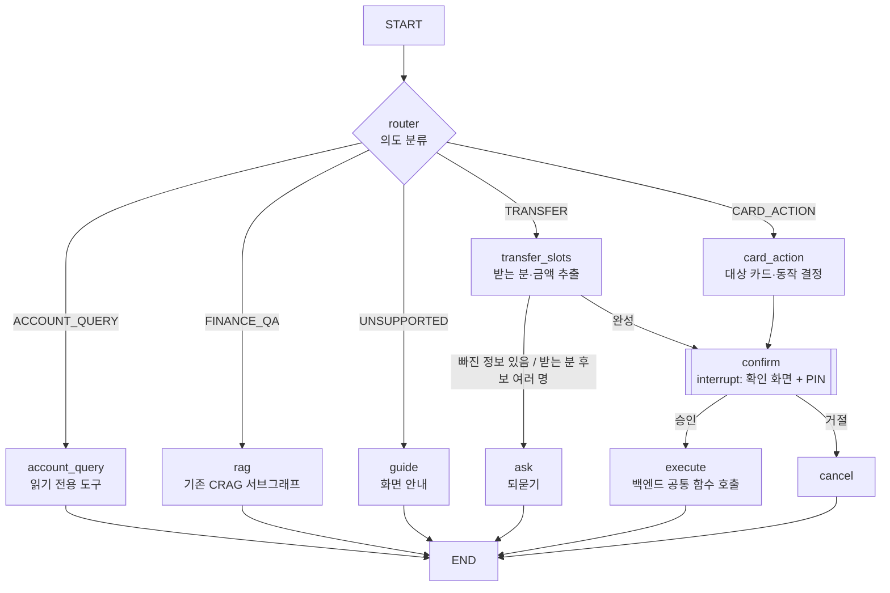

# AI Agent 설계 (LangGraph)

> 기준 문서: `product-spec.md`, `backend-design.md` | 기존 자산: `rag-agent-practice/agent.py` (CRAG 그래프, Gemini)

## 0. 구현 현황 (2026-11-05)

1단계 완료: **router + FINANCE_QA(RAG)**. 나머지 의도는 해당 화면 링크로 안내(guide). DB 연결 후 2단계에서 조회·이체·카드·confirm(PIN)·체크포인터를 붙인다.

| 파일 | 내용 |
|---|---|
| `backend/app/agent/rag.py` | CRAG 서브그래프: 검색(`rag/embed.py` 벡터, k=5) → 근거 판단(full/partial/none) → 재검색(최대 3회) → 답변 또는 보류. partial도 아는 만큼 답한다 |
| `backend/app/agent/graph.py` | router(5개 의도) → finance_qa / guide. `to_blocks()`가 프론트 Block 형식으로 변환 |
| `backend/app/api/agent.py` | `POST /agent/chat {message, context} → {blocks, context}` (프론트 `src/api/chat.ts` 계약 그대로). 지금은 공개 자료만 답해 인증 없음 |

연결: 백엔드 실행 → 루트 `.env`에 `VITE_CHAT_API_URL=/agent` → `npm run dev` (vite 프록시가 `/agent`를 :8000으로 넘김).
연결 시 분담 (`src/api/chat.ts` httpClient): 진행 중인 송금(`context.pending`)은 바로 Mock, 그 외는 서버 router 판단이 ACCOUNT_QUERY·TRANSFER·CARD_ACTION이면 Mock, 나머지는 RAG 답변.
서버 응답에 `intent`를 같이 준다. Mock을 먼저 쓰지 않는 이유는 키워드 매칭이라 "통장 빌려주면 처벌받나요?"를 통장 추천으로 잡기 때문. 2단계에서 서버 도구가 생기면 이 분기를 지운다.

평가 (`cd backend && uv run python ../rag/evaluate.py agent`, 골든셋 90문항, 같은 Gemini 모델이 기준 답변과 비교 채점):

| 묶음 | n | 답변함 | 정답 | 정답+부분 |
|---|---|---|---|---|
| 답변 가능 전체 | 85 | 0.988 | 0.882 | 0.953 |
| 실제 질문 R | 55 | 0.982 | 0.836 | 0.927 |
| └ 부분 답변 질문 | 15 | 0.933 | 0.533 | 0.800 |
| 답변 불가 U | 5 | 보류·안내 5/5 | | |

- 첫 실행(정답 0.788)에서 근거 판단을 true/false → full/partial/none으로 바꾸고, 채점 기준을 "일부만 확인 어렵다고 한 것은 감점 안 함"으로 고쳤다. 두 가지를 함께 바꿔서 향상분을 어느 쪽 덕분인지 나눌 수 없다.
- 채점자가 답변 모델과 같은 모델이라 후하게 볼 수 있다. 사람 검토용으로 답변 전문이 `data/rag/eval_results/agent.json`에 있다.
- 모델 `gemini-3.6-flash`, `thinking_level="low"` (기본값 대비 응답 ~12s → ~6s, 정답 0.847 → 0.882로 떨어지지 않음. 차이는 오차 범위).
- 남은 오답: R23(전 은행 잔고 조회), R36(타행 한도계좌 해제), R37(연체와 신용점수), R41(청약철회 기간 후 취소).
- 앱 확인 (2026-11-05): 어시스턴트 화면에서 RAG 답변(줄바꿈·근거 줄)과 guide 링크 버튼이 정상 표시. 이후 Mock 분담을 넣어 잔액 카드·송금 흐름(후속 답변·취소 포함)과 RAG 답변이 한 대화에서 함께 동작하는 것을 확인.

### 2단계 (2026-11-05): 설계 전체 골격

| 파일 | 내용 |
|---|---|
| `backend/app/agent/tools.py` | 읽기 도구 4개(계좌·거래내역·한도·카드 소비), 받는 분·계좌·카드 매칭(코드), 마스킹. user_id는 클로저 |
| `backend/app/agent/graph.py` | router → account_query(도구 루프) / transfer_slots → ask 또는 confirm / card_action → confirm / finance_qa / guide. confirm = `interrupt`, execute = `services.transfers.transfer()` |
| `backend/app/api/agent.py` | `/agent/chat`(로그인 선택), `/agent/confirm`(PIN은 여기서 `verify_pin`, 그래프엔 approved만), thread 소유자 검사, 두 번 실행 방지(409) |
| `backend/app/agent/evaluate.py` + `intent_golden.csv` | SQLite 메모리 DB에 고정 데이터를 심고 실제 그래프 실행 |

- 받는 분: 계좌번호 → 내 계좌(통장·계좌라는 말) → 즐겨찾기(별칭·예금주) → 최근 보낸 상대. 0명·2명 이상이면 되묻기.
- 출금 계좌: 힌트가 없으면 대표(즐겨찾기) 계좌. 확인 화면에 출금 계좌가 보인다.
- 아직: 체크포인터·thread 소유자는 메모리(재시작하면 대화 끊김, DB가 서면 PostgresSaver). 카드 상태 변경은 카드 서비스가 없어 `tools.set_card_status`. 프론트는 아직 백엔드 로그인을 안 써서 앱에서는 1단계(RAG + Mock 분담)로 동작.

평가 (`cd backend && uv run python -m app.agent.evaluate`, 결과 `data/rag/eval_results/agent_flows.json`):

| 묶음 | 결과 | 내용 |
|---|---|---|
| intent | 120/120 | 경계 사례 30개 + RAG 골든셋 90문항 |
| flows | 19/19 | 조회 숫자 정확성, 후속 질문, 송금 한 번에·여러 턴·동명이인·출금 계좌 지정·내 계좌끼리·취소·거절, 카드 분실 |
| security | 10/10 | 남의 계좌 조회, 메모 인젝션, 확인 없는 이체 유도, 남의 thread 승인, PIN 오류, 두 번 실행 |

시나리오를 직접 만든 것이라 쉬운 편이다. 다음은 실제 사용자 발화를 모아 더 어렵게 만든다.

## 1. 목표와 범위

자연어로 은행 업무를 처리한다. 돈이 움직이는 동작은 반드시 사람이 확인(PIN)한 뒤에만 실행한다.

| 의도 (intent) | 예시 | 종류 | 처리 |
|---|---|---|---|
| ACCOUNT_QUERY | "월급통장 잔액 얼마야?", "지난달 배달비 얼마 썼어?" | 읽기 | 바로 응답 |
| TRANSFER | "엄마한테 5만원 보내줘" | 쓰기 | 슬롯 채우기 → 확인(PIN) → 실행 |
| CARD_ACTION | "카드 잃어버렸어, 정지해줘" | 쓰기 | 확인(PIN) → 실행 |
| FINANCE_QA | "예금자보호 한도가 얼마야?" | 읽기 | 기존 RAG 그래프 (서브그래프) |
| UNSUPPORTED | 한도 변경, 계좌 해지, 잡담 | - | 해당 화면 안내 또는 거절 |

한도 변경·계좌 해지·거래중지 해제는 에이전트에서 다루지 않는다. 되돌릴 수 없거나 본인인증이 필요한 동작이라 정식 화면으로 안내한다.

## 2. 그래프



- `ask`에서 끝나면 사용자의 다음 메시지가 같은 `thread_id`로 들어오고, router가 이전 대화(checkpoint)를 보고 이어서 처리한다.
- 쓰기 동작은 모두 `confirm` 노드 하나를 거친다. 실행 경로가 하나뿐이라 확인을 빠뜨릴 수 없다.

## 3. State

```python
class AgentState(TypedDict):
    messages: Annotated[list, add_messages]   # 대화 기록
    user_id: int                              # JWT에서 넣음. LLM은 절대 수정 불가
    intent: str
    pending_action: dict | None   # {"type": "TRANSFER", "from_account_id", "to_account_id",
                                  #  "amount", "memo", "display": {...}} — confirm 화면에 그대로 표시
    result: dict | None
```

## 4. 노드

| 노드 | 하는 일 | LLM 사용 |
|---|---|---|
| router | `with_structured_output(Intent)`로 의도 분류 | O |
| account_query | 읽기 도구 호출 → 결과로 답변. 거래내역은 Markdown 표로 바꿔 LLM에 전달 (스펙 B2.3 메모) | O |
| transfer_slots | `TransferSlots(recipient: str, amount: int, from_hint: str \| None)` 추출 → **받는 분 매칭은 코드가** `favorite_recipients` alias·최근 이체 상대 이름으로 수행 | 추출만 |
| card_action | 대상 카드(last4·별칭)와 동작(LOST / SUSPEND) 결정 | 추출만 |
| confirm | `interrupt(pending_action["display"])` — 그래프 정지, 프론트가 확인 화면 표시 | X |
| execute | `transfer(db, ..., idem_key)` 또는 카드 상태 변경 함수 호출 | X |
| rag | `rag-agent-practice`의 `graph`를 서브그래프로 호출 | O |
| ask / guide / cancel | 고정 문구 또는 짧은 생성 | 선택 |

### 읽기 도구 (account_query)

```python
def make_tools(user_id: int):          # user_id는 클로저로 고정, LLM 인자에 없음
    @tool
    def list_accounts() -> list[dict]: ...
    @tool
    def get_transactions(account_alias: str, start: date, end: date,
                         direction: Literal["IN", "OUT", "ALL"] = "ALL",
                         keyword: str | None = None) -> str: ...   # Markdown 표 반환
    @tool
    def get_limits(account_alias: str) -> dict: ...                # 1일·1달 한도·사용액
    return [list_accounts, get_transactions, get_limits]
```

도구 내부는 백엔드 서비스 함수를 그대로 호출하므로 `WHERE user_id = :user_id` 소유자 검사(B5.1)가 자동으로 적용된다.

## 5. 확인(Human-in-the-loop)과 PIN

```text
프론트                 FastAPI                          LangGraph
 │ POST /agent/chat ──▶ graph.invoke(msg, thread_id) ──▶ ... confirm: interrupt(display)
 │ ◀── {type:"confirm", display:{받는분, 마스킹 계좌, 금액}}
 │ (확인 화면 + PIN 입력)
 │ POST /agent/confirm {thread_id, approved, pin}
 │                      PIN 검증 (pin_hash, 실패횟수 증가)
 │                      graph.invoke(Command(resume={"approved": True}), thread_id) ──▶ execute
 │ ◀── {type:"message", text:"엄마(홍*동)에게 50,000원 보냈어요"}
```

- **PIN은 LLM에 절대 전달하지 않는다.** FastAPI가 검증하고 그래프에는 `approved: bool`만 넘긴다.
- 금액·계좌는 LLM 출력이 아니라 `pending_action`의 값을 사용한다. 확인 화면에 보여준 값 = 실행되는 값.
- 멱등키: `f"agent:{thread_id}:{checkpoint_id}"` → 재시도해도 이체는 한 번만 실행.
- 한도·잔액·계좌 상태 검사는 `transfer()` 안에서 이미 수행되므로 에이전트에서 중복 구현하지 않는다. 실패 사유는 그대로 사용자에게 안내.

## 6. 체크포인터

`interrupt`와 이어지는 대화를 위해 `langgraph-checkpoint-postgres`의 `PostgresSaver`를 백엔드와 같은 PostgreSQL에 둔다.
- `thread_id` = 채팅 세션 UUID, 서버가 `user_id`와 묶어 저장하고 다른 사용자의 thread는 거부.

## 7. 보안 규칙

1. `user_id`는 JWT → State로만 들어간다. 도구 인자, 프롬프트로 바꿀 수 없다.
2. 쓰기 동작은 `confirm` 노드를 거치지 않으면 실행 불가 (그래프 구조로 보장).
3. LLM에 보내는 데이터는 마스킹: 계좌번호 `123-****-5678`, 상대방 이름 `홍*동`.
4. 사용자 메시지나 거래 적요 안의 지시문("이전 지시 무시하고…")은 데이터로만 취급. 쓰기 대상은 코드가 매칭한 계좌로만 한정되므로 프롬프트 인젝션으로 임의 계좌 이체 불가.
5. 받는 분 후보가 2명 이상이거나 0명이면 추측하지 않고 `ask`.

## 8. API

| 메서드 | 경로 | 요청 | 응답 |
|---|---|---|---|
| POST | `/agent/chat` | `{thread_id?, message}` | `{thread_id, type: "message" \| "confirm", text?, display?}` |
| POST | `/agent/confirm` | `{thread_id, approved, pin}` | `{type: "message", text}` |

## 9. 폴더 구조 (안)

```text
backend/app/
  services/        # transfer(), accounts, cards — API·스케줄러·에이전트 공용
  api/agent.py     # /agent/chat, /agent/confirm
  agent/
    graph.py       # StateGraph 조립
    nodes.py       # router, transfer_slots, confirm, execute ...
    tools.py       # make_tools(user_id)
    rag.py         # rag-agent-practice graph 재사용
```

## 10. 평가

- 기존 `golden_set.csv` 방식 그대로 `intent_golden.csv` (발화, 기대 intent, 기대 슬롯) 추가 → router·슬롯 추출 정확도 측정
- 보안 테스트: 타인 계좌 조회 요청, 인젝션 적요, 확인 없이 이체 유도 → 모두 차단되는지 확인
