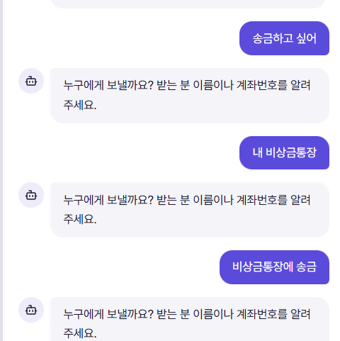

# 오류 기록

## AGENT-001 — 내 계좌로 송금할 때 받는 계좌를 반복해서 질문함

- 기록일: 2026-11-05
- 상태: 미해결 · 기록만 완료, 수정·원인 분석 미진행
- 위치: AI 은행 어시스턴트 → 송금 대화
- 근거: 사용자가 제공한 스크린샷

### 재현 대화

1. 사용자: `송금하고 싶어`
2. 어시스턴트: `누구에게 보낼까요? 받는 분 이름이나 계좌번호를 알려 주세요.`
3. 사용자: `내 비상금통장`
4. 어시스턴트: 같은 수취인 질문을 반복함.
5. 사용자: `비상금통장에 송금`
6. 어시스턴트: 같은 수취인 질문을 다시 반복함.

### 기대 동작

사용자가 제시한 본인 계좌를 받는 계좌 후보로 확인하고, 출금 계좌·금액 등 부족한 정보를 다음으로 질문해야 한다. 계좌를 특정하지 못했다면 본인 계좌 후보를 보여 주거나 구체적인 확인 질문을 해야 한다.

### 실제 동작

계좌명을 두 차례 알려 줘도 다음 단계로 진행하지 않고 같은 질문을 반복한다. 실제 송금 실행 여부는 스크린샷에서 확인되지 않는다.

