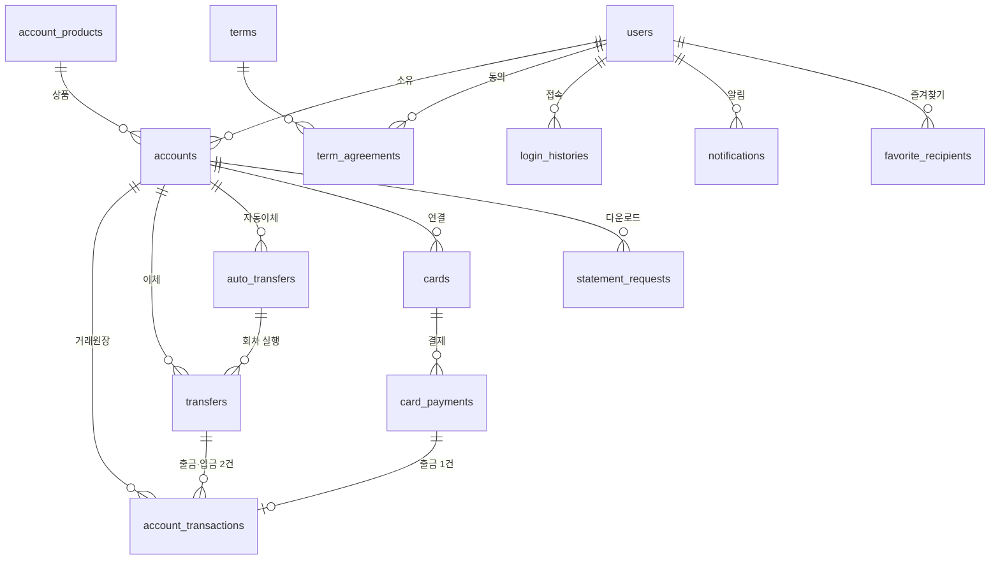

# DB 설계 (Database Design)

> 스키마 원본: [`bank.dbml`](bank.dbml) — drawDB에서 **파일 → 가져오기 → DBML**, 데이터베이스는 PostgreSQL
> 기준 문서: `product-spec.md` (2026-11-05) 5절 필수 기능 | 선택 기능(소셜 로그인, 예약이체, 다건이체, 신용카드 등)은 제외

## 1. 테이블 한눈에 보기 (15개)



| 영역 | 테이블 | 한글명 | 행이 생기는 때 | 기획서 |
|---|---|---|---|---|
| 회원·인증 | `users` | 회원 | 회원가입 | A1, A2, A3 |
| | `terms` | 약관 | 관리자가 약관 등록 | A1, B1.2 |
| | `term_agreements` | 약관 동의 내역 | 가입·계좌개설 시 약관마다 | A1, B1.2 |
| | `verification_codes` | 본인확인 인증번호 | 인증번호 요청할 때마다 | A1, A3, B3.3.2 |
| | `login_histories` | 로그인 접속 기록 | 로그인 시도할 때마다 | A2.4 |
| | `notifications` | 알림 | 카드 결제, 이상 접속, 자동이체 실패 | A2.4, D1.5 |
| 계좌 | `account_products` | 계좌 상품 | 관리자가 상품 등록 | B1.1, B2.2 |
| | `accounts` | 계좌 | 계좌 개설 | B1~B5 |
| | `account_transactions` | 거래내역 (거래원장) | 돈이 움직일 때마다 | B2.3~B2.6 |
| | `statement_requests` | 거래내역 다운로드 신청 | 다운로드 신청 | B2.7 |
| 이체 | `transfers` | 이체 | 즉시이체, 자동이체 1회차 | C1, C2 |
| | `auto_transfers` | 자동이체 | 자동이체 등록 | C2.1 |
| | `favorite_recipients` | 자주 쓰는 받는 계좌 | 별표 등록 | C3 |
| 카드 | `cards` | 체크카드 | 발급, 재발급 | D1.1~D1.4 |
| | `card_payments` | 카드 결제내역 | 카드 결제 | D1.3, D1.5 |

## 2. 공통 규칙

| 규칙 | 내용 | 이유 |
|---|---|---|
| 금액 | `bigint`, 원 단위 정수 | float는 소수 오차가 생김 |
| 시각 | `timestamptz` | 서버·DB 시간대가 달라도 같은 순간을 가리킴 |
| 상태값 | `varchar` + note에 가능한 값 표기 (예: `ACTIVE / SUSPENDED / CLOSED`) | 값 추가가 쉬움 |
| 비밀값 | 비밀번호·PIN·통장 비밀번호·인증번호는 **해시**로 저장 | 기획서 "복호화 가능한 평문 저장 금지" |
| 카드번호 | **암호화**해서 저장, 화면에는 끝 4자리만 | 결제에 원문이 필요해서 해시 불가. CVC는 저장하지 않음 |
| 삭제 | 회원·계좌·카드는 지우지 않고 상태만 바꿈 (soft delete) | 해지 후에도 거래내역 보관 (B4.3) |
| 소유자 확인 | 모든 조회에 `user_id = JWT의 사용자 ID` 조건 | B5.1 |

## 3. 기능별 처리 방식

### 3.1 본인확인 — 이메일 인증번호 (A1, A3, B3.3.2)
기획서는 "인증번호 본인확인"만 정하고 채널은 정하지 않았다 (이미지의 SMS는 확정 아님). 비용이 들지 않는 **이메일**로 보낸다.

```text
[인증번호 받기] → 6자리 랜덤 생성 → verification_codes 저장 (email, purpose, code_hash, expires_at=+3분) → 메일 발송
[인증번호 입력] → 같은 email·purpose의 최신 행 조회 → 만료? 5회 초과? 해시 일치? → verified_at 기록
[다음 단계]     → 해당 email·purpose에 방금 verified_at이 있어야 가입 완료 / 거래중지 해제 / 비밀번호 재설정
```

- `purpose`로 용도를 나눠 가입용 번호를 거래중지 해제에 못 쓰게 한다.
- 발송: Python 기본 `smtplib` + Gmail 앱 비밀번호 (무료, 하루 약 500통). 개발 중에는 콘솔 출력.
- B2.7 거래내역 다운로드도 같은 메일 발송 기능을 쓴다.
- 한계: "메일함 접근 가능"만 확인한다. 실서비스라면 휴대폰 본인확인(PASS·NICE)이 필요하다.

### 3.2 로그인 유지 — refresh token 없음 (A2.1, A2.3)
- Access token(JWT) 15분. 만료되면 **PIN 6자리로 재로그인**한다.
- 수동 로그아웃: 프론트가 토큰 삭제. 무활동 자동 로그아웃: 프론트 타이머 + 짧은 만료.
- 한계: 탈취된 토큰은 만료 전까지 유효. 서버 강제 무효화가 필요해지면 `users.token_version` 컬럼 하나만 추가한다.

### 3.3 로그인 ID와 상품 코드
- 로그인 ID는 **이메일** (`users.email`). 프론트가 이메일로 가입·로그인한다.
- 상품은 `account_products.code`(`basic`, `parking`, `youth`, `living`, `group`)로 가리킨다. 프론트 `src/data/mock.ts`의 상품 id와 같다. 혜택·설명 원문은 당분간 `mock.ts`가 원본.

### 3.4 잠금과 거래중지는 따로 (A2.4, B3.3)
기획서 "로그인 잠금과 계좌 거래중지는 별도 상태로 구분"에 따라 어디서 틀렸는지로 나눈다.

| 실패 상황 | 카운터 | 5회가 되면 |
|---|---|---|
| 로그인 비밀번호 | `users.login_fail_count` | `users.status = LOCKED` (로그인 불가, 비밀번호 재설정으로 해제) |
| PIN 로그인 | `users.pin_fail_count` | `users.status = LOCKED` |
| 이체·한도 변경·해지 등 **계좌 작업 중 PIN** | `users.pin_fail_count` | 그 계좌만 `accounts.status = SUSPENDED` (인증번호로 해제) |
| 통장 비밀번호 (개설 시 확인만) | `accounts.password_fail_count` | 현재 쓰는 화면 없음 |

### 3.5 거래원장 (B2)
- 돈이 움직이면 `account_transactions`에 남기고 **수정·삭제하지 않는다**.
- 계좌이체 1건 = 원장 2행 (보내는 계좌 OUT, 받는 계좌 IN). 카드 결제 1건 = 원장 1행 (OUT).
- 상대방·적요를 원장에 직접 저장해서 거래 상세(B2.4)와 검색(B2.6.1)을 조인 없이 처리한다. 카드 결제의 상대방은 가맹점명.
- 인덱스 `(account_id, transaction_at)`으로 기본 조회(3개월, 최신순)를 처리한다.

### 3.6 이체 (C1)
- `transfers.idempotency_key` UNIQUE: 프론트가 이체 화면마다 UUID를 만들어 보낸다. 같은 키가 다시 오면 새로 이체하지 않고 기존 결과를 돌려준다 → 버튼 두 번 클릭, 응답 유실 후 재전송 모두 1번만 송금 (TC-E-003, 004).
- 출금·입금·원장 2행을 **하나의 트랜잭션**으로 처리하고, 두 계좌를 id 순서로 잠가 데드락을 막는다.
- 한도(C1.2): 별도 컬럼 없이 원장에서 오늘·이번 달 이체 출금 합계를 구해 `daily_limit`, `month_limit`과 비교한다. 카드 결제는 이체한도에 넣지 않는다.

### 3.7 자동이체·예약이체 (C2.1)
- 둘 다 `auto_transfers` 1행. `cycle`: `ONCE` 예약이체(지정 시각 1회) / `WEEKLY` / `MONTHLY`.
- 스케줄러가 1분마다 `status = ACTIVE AND next_run_at <= 지금`인 행을 찾아 이체 공통 함수로 실행하고 `next_run_at`을 다음 회차로 옮긴다 (`ONCE`는 실행 후 `ENDED`).
- 회차당 1번만 실행 (TC-F-006): 멱등키를 `auto:{자동이체 id}:{실행 시각}`으로 만든다.
- 실행된 이체는 `transfers.auto_transfer_id`로 연결한다. 실패하면 `notifications`에 `AUTO_TRANSFER_FAIL`.

### 3.8 즐겨찾기·최근 계좌 (B3.1, C3)
| 기능 | 저장 |
|---|---|
| 내 계좌 홈 상단 고정 | `accounts.is_favorite` |
| 받는 계좌 별표 | `favorite_recipients` |
| 최근 보낸 계좌 | 저장 안 함. `transfers`에서 받는 계좌별 최신순 조회 |

### 3.9 계좌 해지 (B4)
해지 가능 = `balance = 0` AND 연결된 활성 카드 0개 AND 활성 자동이체 0개 AND `status = ACTIVE`.
해지하면 `status = CLOSED`, `closed_at` 기록. 행은 남아 있어 거래내역 조회 가능.

| 상태 | 조회 | 입금 | 출금·이체 | 관리 변경 | 해지 |
|---|---|---|---|---|---|
| ACTIVE 정상 | O | O | O | O | O |
| SUSPENDED 거래중지 | O | X | X | X (본인확인 후 해제만 예외) | X |
| CLOSED 해지 | O | X | X | X | X |

### 3.10 카드 (D1)
- 체크카드는 계좌에 종속 (`cards.account_id`). 결제하면 `card_payments` 1행 + 연결 계좌 원장 1행 + 결제 알림.
- 분실·정지는 `status`만 변경. 재발급은 새 카드 행을 만들고 `reissued_from_id`로 이전 카드를 가리키며, 이전 카드는 `REISSUED`.

### 3.11 알림 (A2.4, D1.5)
모바일 웹이라 푸시가 어려워 DB에 저장하고 앱을 열 때 목록으로 보여준다 (SCR-011 결제 알림 영역, 알림 없음 상태, 읽음 표시).
기획서 미해결 이슈에서 알림 채널이 SMS·이메일로만 확정되면 이 테이블은 빼도 된다.

## 4. 일부러 만들지 않은 것

| 빠진 것 | 이유 |
|---|---|
| `refresh_tokens` | 3.2 참고. 짧은 access token + PIN 재로그인 |
| 한도 사용액 카운터 | 원장 합계로 계산. 느려지면 추가 |
| 최근 이체 계좌 테이블 | `transfers`에서 조회 |
| 카드 CVC | 저장 금지 (PCI DSS) |
| 선택 기능 (예약이체, 다건이체, 신용카드, 소셜 로그인, 신분증 확인) | 기획서 3.1절 MVP 제외 |

## 5. 기획서 미정 정책 — 확정되면 반영

| 미정 항목 (기획서 하단) | 영향받는 곳 |
|---|---|
| 잠금 횟수·해제 절차 | `*_fail_count` 기준값 (지금은 5회로 가정) |
| 거래중지 상태의 카드 결제 허용 여부 | 카드 결제 처리 로직 |
| 자동이체 실행 시각·실패 재시도·말일 처리 | `auto_transfers` (재시도 횟수 컬럼 등) |
| 다운로드 파일 형식 | `statement_requests` |
| 알림 채널 | `notifications` 유지 여부 |
| 회원 탈퇴 제한 | 탈퇴 처리 로직 |

## 6. 백엔드 코드와의 차이

`backend/app/models.py`는 이 문서보다 먼저 만든 뼈대라 이름이 다르다 (`transactions` ↔ `account_transactions`, `account_number` ↔ `account_num`, id 타입 등).
이 DBML을 기준으로 모델과 마이그레이션을 다시 맞춰야 한다.
